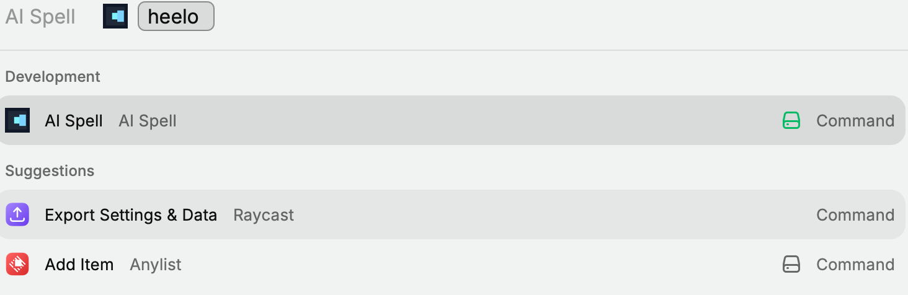
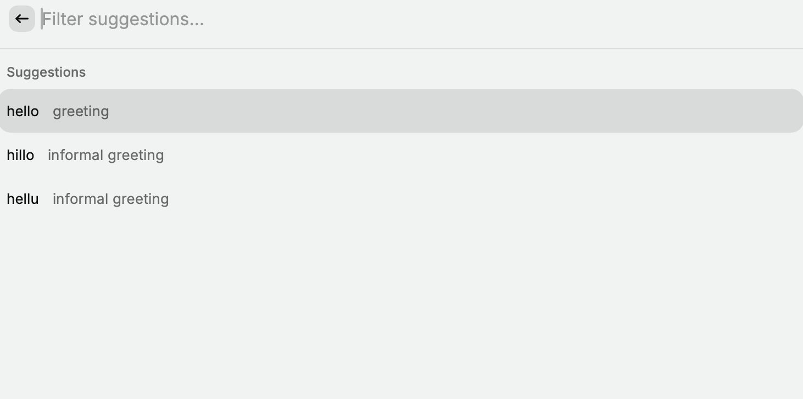

# AI Spell

AI Spell is a small Raycast extension that asks a macOS Shortcut for spelling suggestions and brief definitions. Select a result to copy it or paste it into the app you were using.

The idea is to make checking an uncertain spelling a quick keyboard workflow. Definitions help distinguish similar words, while Shortcuts provides the connection to Apple Intelligence without a separate model service in the extension.

## Features

- Up to three distinct suggestions, shown in the order returned by the model.
- Inline definitions and filtering by word or definition.
- Copy, paste, and retry actions with keyboard shortcuts.
- A configurable Shortcut name.
- Validation of model output, with errors and retry when no usable suggestions are returned.

## How it works

```text
Raycast → macOS Shortcuts → Apple Intelligence → JSON response → Raycast list
```

Raycast writes the entered text to a temporary file and invokes `/usr/bin/shortcuts`. The included Shortcut passes Shortcut Input to its **Use Model** action, configured for **Apple Intelligence on Device**, then returns the response. The extension reads the output, validates it, removes duplicates, and displays up to three suggestions.

The extension makes no direct model API calls and contains no API keys. The included Shortcut selects the on-device model, but this is not a guarantee that the entire workflow is private or offline. Inspect the imported Shortcut and its model selection before using sensitive text. Suggestions and definitions can be incorrect; review them before pasting.

## Requirements

- An Apple Intelligence-capable Mac (M1 or later) with macOS Tahoe 26 or later, including the **Use Model** action in Shortcuts.
- Apple Intelligence enabled, with the required model downloaded and a supported language and region. See [Apple's availability and requirements](https://support.apple.com/en-us/121115).
- Raycast for macOS with extension development support.
- Node.js 22.22.2 or later and npm for installing and building from source. The repository's `.tool-versions` pins Node.js 22.22.2.

No Raycast AI subscription or separate model download managed by this extension is needed.

## Installation

Download or clone this repository and open a terminal in its directory.

### Import the Shortcut

1. Open [assets/spelling.shortcut](assets/spelling.shortcut) in Finder and follow the Shortcuts import dialog. The file is signed for import by anyone.
2. Name the imported Shortcut **spelling**. If Shortcuts gives it another name, either rename it or set that exact name in AI Spell's **Siri Shortcut Name** preference.
3. Open the Shortcut editor. Confirm that **Use Model** selects **Apple Intelligence on Device**, that its prompt contains the **Shortcut Input** variable, and that **Stop and Output** returns the model response.
4. Run it once with sample text and allow any macOS permission prompts. If testing in the editor requires input, temporarily supply sample text, then restore the Shortcut Input variable.

The prompt is reproduced below. If you edit it, keep Shortcut Input as an actual Shortcuts variable, rather than typing those words as literal text. The final output must be text containing JSON, not a dialog or a screenshot.

### Install the extension

```sh
npm ci
npm run typecheck
npm test
npm run build
npm run dev
```

`npm run dev` starts Raycast development mode with live rebuilding. Open **AI Spell** in Raycast. For a local source import, Raycast also provides an **Import Extension** command; select this repository's directory. See [Raycast's getting-started guide](https://developers.raycast.com/basics/getting-started).

The build writes the extension bundle into Raycast's local extensions directory. This repository is installed from source; these instructions do not assume a Raycast Store listing.

## Usage

Open **AI Spell**, enter a word or short text in its argument, and wait for suggestions.



Suggestions appear with brief definitions:



Select a result and use:

| Key | Action |
| --- | --- |
| Enter | Copy the selected correction |
| Cmd+Enter | Paste the selected correction into the active app |
| Cmd+R | Run the check again |

Typing in the results search bar filters suggestions; it does not submit new text to the model. Run the command again to check different input. Only the selected suggestion is copied or pasted, so review how it fits your original text.

## Shortcut prompt

The included Shortcut uses this prompt, with the Shortcut Input variable inserted at the end of the first line:

```text
Provide spelling suggestions for the following Shortcut Input:

Return exactly 3 suggestions as valid JSON using this schema:

[
  {
    "word": "suggested spelling",
    "definition": "brief definition"
  }
]

Return only the JSON array. Do not include Markdown, code fences, explanations, or any other text.

Rank suggestions from most likely to least likely.
```

This is a request to the model, not a guarantee of valid JSON or exactly three results. Each entry must contain nonempty `word` and `definition` strings. The extension also accepts a `suggestions` wrapper and Markdown-fenced JSON. Invalid entries and duplicates are skipped. Fewer than three valid suggestions are displayed without padding; an empty or unusable response is an error, not a reliable indication that the input is already correct.

## Troubleshooting

- **Shortcut cannot be found:** check its name in Shortcuts and the command preference, including spelling and spaces.
- **Model unavailable or permissions requested:** run the Shortcut directly, check Apple Intelligence settings, and resolve any prompts before retrying in Raycast.
- **Invalid JSON or no valid suggestions:** check the prompt and final output action. Retry if the model returns malformed output.
- **No text returned:** confirm that Stop and Output returns the model response as text.
- **Timeout:** each run has a two-minute subprocess timeout. Check whether the Shortcut is waiting for interaction, then retry.
- **Paste does not work:** verify Raycast's Accessibility permission in macOS settings and test in an ordinary editable text field.

## Technical overview and development

The extension uses TypeScript, React, Raycast's API, and Node.js subprocess/filesystem APIs. `src/check-text.tsx` owns the UI and request lifecycle; `src/shortcut.ts` runs the Shortcut and parses its output. There is no server, database, or direct model SDK.

Each request uses a unique temporary directory and an input file with owner-only permissions. A single CLI invocation requests a plain-text output file; nonempty file output takes precedence over stdout. Temporary files are removed in `finally`. Cancellation aborts the CLI process and prevents stale UI updates; it does not establish that every downstream model operation stops immediately. The subprocess output buffer is capped at 1 MiB. The extension contains no explicit logging of submitted text or model responses.

```sh
npm run typecheck  # strict TypeScript checks
npm test           # parser and runner tests, without invoking a real Shortcut
npm run build      # compile the Raycast extension
npm run dev        # live development in Raycast
```

Tests use Node's built-in test runner and the existing TypeScript compiler. They cover response formats, validation, deduplication, ranking, output-file/stdout handling, cancellation, and cleanup after simulated failures. They do not verify model quality, macOS import dialogs, or Raycast copy/paste behavior. No separate linter is configured.

The editable icon source and PNG are in `assets/`. If you change the Shortcut in Shortcuts, export it and sign the export for sharing:

```sh
shortcuts sign --mode anyone --input exported.shortcut --output assets/spelling.shortcut
```

Before sharing a changed export, inspect its actions and confirm it contains no personal data or credentials. Test importing it on another compatible Mac, then follow the setup instructions from a fresh checkout.

## Codex during development

Codex was used to review the repository, document its implementation, and align the extension's response parsing with the Shortcut's JSON schema. The fix was checked with parser exercises, TypeScript checking, and a Raycast build; the maintainer then confirmed that the extension worked.

Codex also assisted with the focused reliability cleanup, automated tests, and publication documentation in this repository. These are documented uses of Codex; they do not describe how the original prototype was developed.

## License

[MIT](LICENSE).
